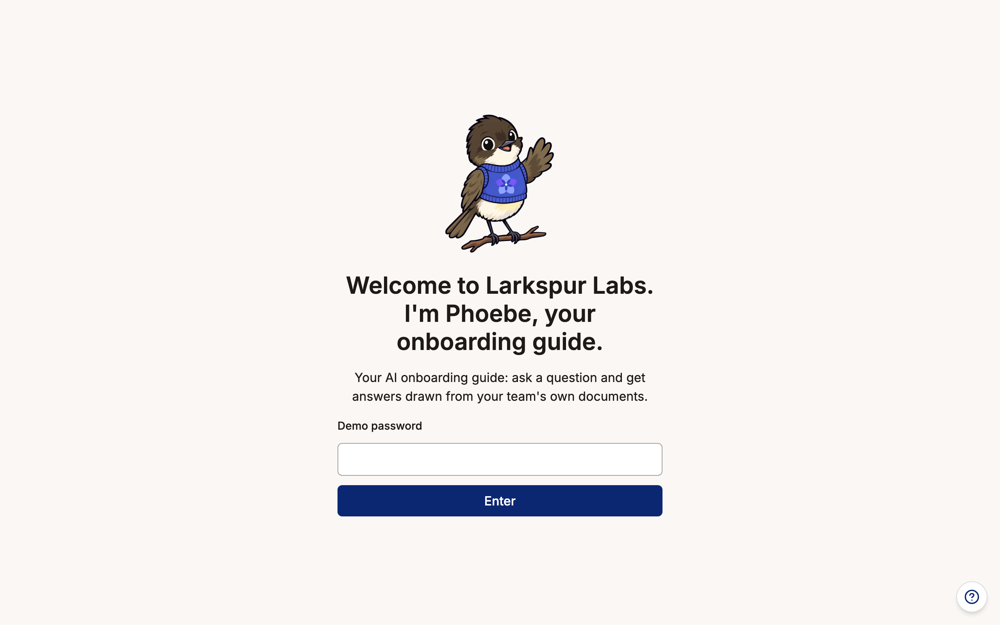
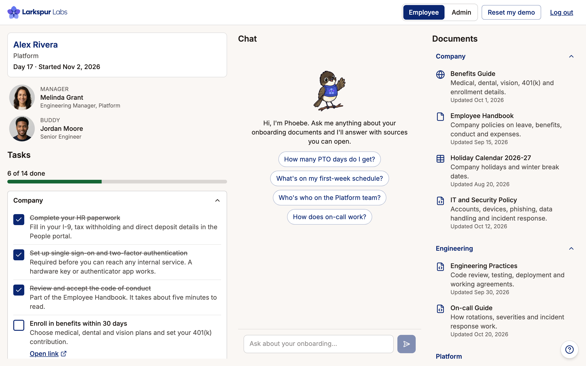
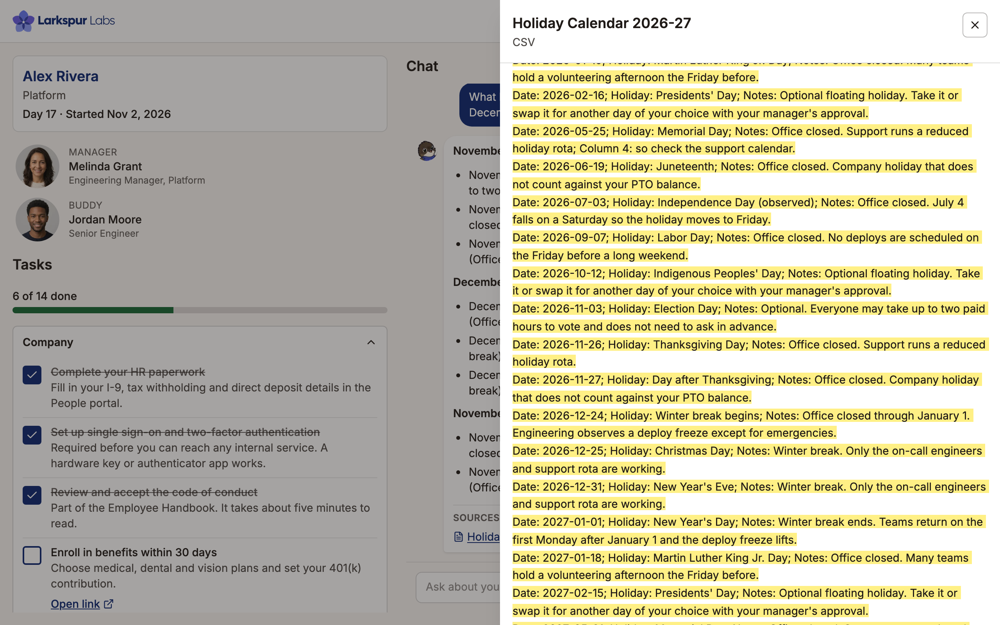
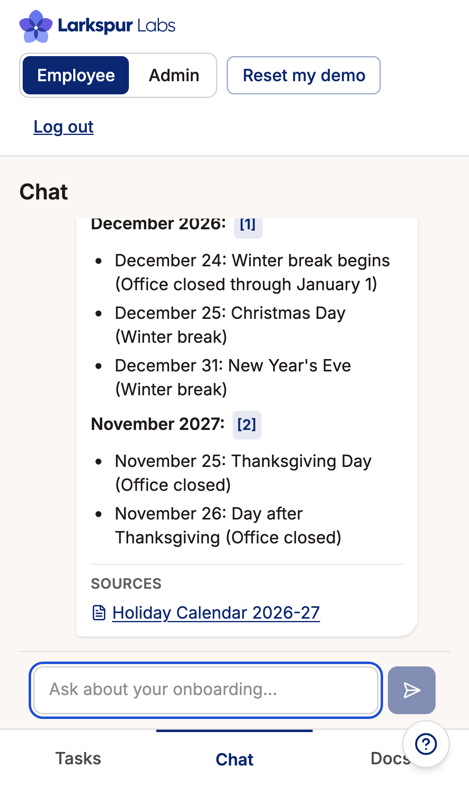
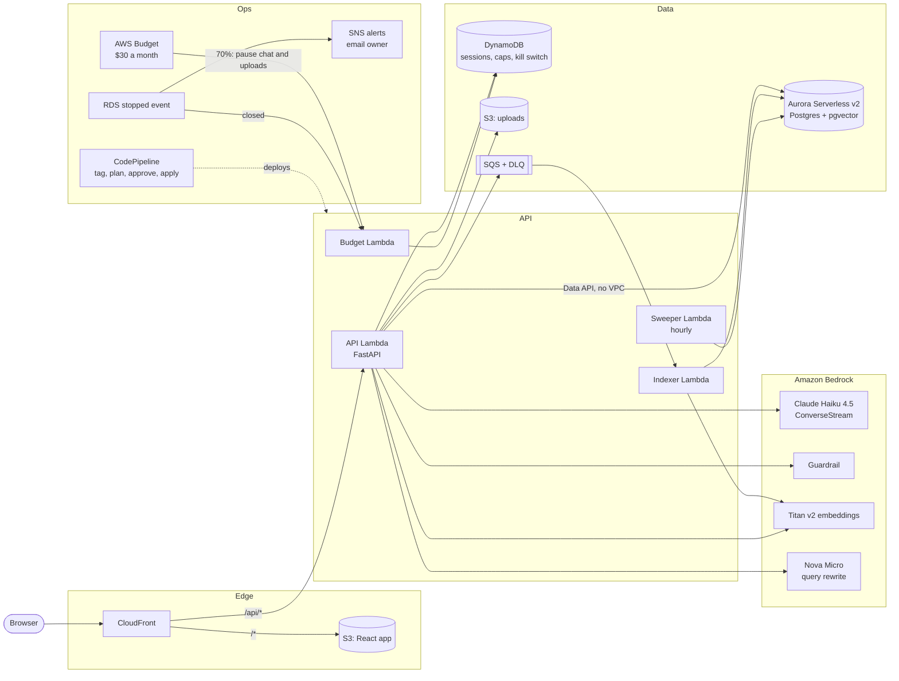

# Phoebe

An onboarding portal for a fictional company, Larkspur Labs. A new hire sees their onboarding tasks and asks an assistant questions. Every answer cites the company documents it came from, and the assistant only sees the documents that hire is allowed to read. All data is synthetic.

| | |
|---|---|
|  |  |
|  |  |

**Live demo:** https://phoebe-onboarding.hochoy.dev (password provided with this link)

FastAPI · Postgres with pgvector · React and TypeScript · Amazon Bedrock (Claude Haiku 4.5) · AWS Lambda and Aurora Serverless · Terraform

## What it does

- **Personas and groups.** You sign in as Alex Rivera, a new hire on the Platform team. Alex belongs to some groups (the whole company, Engineering, Platform) and not others (Sales, Payments). The tasks, documents and answers follow those groups.
- **Cited answers.** Questions are answered only from the documents Alex can read. Each claim links to its source, and clicking a source opens the document at the quoted passage.
- **Refusals.** When the documents don't cover a question, or the answer can't be checked against its sources, Phoebe says so instead of guessing. Refusals other than "I couldn't find that" show a short numeric code.
- **A private sandbox.** Each visitor can upload documents or add links. Only that visitor's session sees them, and they are wiped when the session ends.
- **An admin view** manages tasks, documents and group visibility for the seeded company.

## Architecture

A question goes through these steps:

1. **Screen.** The Bedrock Guardrail checks the question.
2. **Rewrite.** Nova Micro rewrites a follow-up question into one that stands alone.
3. **Search.** Titan embeds the rewritten question. Postgres then runs hybrid vector and full-text search over the chunks this visitor may see.
4. **Answer.** Haiku answers from the top passages and labels each claim with the passage it came from. The answer streams to the browser over server-sent events as it is written.
5. **Check.** When the answer finishes, a verifier checks that every label matches a passage Haiku was given, and the Guardrail checks the answer. If either check fails, the streamed text is replaced with a refusal.

## Trade-offs

- **pgvector instead of Bedrock Knowledge Bases or Pinecone.** Who-can-see-what is the core of the demo. In Postgres, the group filter and the per-visitor sandbox are part of the same SQL query as the vector and full-text search, so the documents a visitor can see and the documents search returns can't drift apart. Knowledge Bases and Pinecone would each need a second copy of the permissions in their own metadata, kept in sync. Knowledge Bases' default vector store also has a standing monthly minimum, while Aurora scales to zero.
- **Direct Bedrock calls instead of the AgentCore harness.** Answers first went through an AgentCore harness. The harness can only reach documents through Gateway tools, and those can't apply Phoebe's visibility model, so retrieval stayed in the API and the harness only relayed the model call. Calling Bedrock ConverseStream directly passed the same eval cases at about a third of the median latency (table below). It also took AgentCore, $0.47 of the month's $1.57, off the answer path; the harness stays deployed for one release as the rollback.
- **The Aurora Data API instead of a VPC.** A Lambda inside a VPC needs a NAT gateway (about $32 a month standing) or several VPC endpoints to reach Bedrock. The Data API lets Lambda reach Aurora over HTTPS with IAM, so nothing runs in a VPC. Aurora itself is still not publicly accessible.
- **Aurora that scales to zero.** It costs almost nothing when idle. The price is a resume of up to about 30 seconds after a pause. A warm-up call at sign-in starts the resume early.

## Permission-aware retrieval

- **Groups.** Every seeded document belongs to groups. Search filters on the visitor's groups before ranking, so an answer can never cite a document outside them.
- **Sandbox.** Each login gets a private sandbox, held in a cookie session (2 hours idle, 24 hours at most). Uploads, links, task progress and edits live in that sandbox, layered over the shared seed data. An hourly sweeper deletes expired sandboxes with their rows, chunks and files.
- **The 0-leak test.** This test is required to pass. Across sessions and groups, retrieval must never return another session's chunks, hidden chunks, or chunks outside the visitor's groups.

## Spend safety

The demo is public behind one shared password, so cost has hard limits:

- **Caps.**
  - Chat: 30 questions per session per hour and 300 a day across all sessions.
  - Uploads and links: 5 per session and 50 in total, both per day.
  - Logins: 10 attempts per IP every 15 minutes.
- **Kill switch.** The owner can set the demo to open, paused (browsing works, chat and uploads are off) or closed.
- **Spend-limit mode.** At 70% of the $30 monthly budget, chat and uploads pause on their own and a banner explains why. If the database is stopped, the site shows an offline notice and the owner gets an email. Nothing spends money to recover by itself: the owner runs `make db-start`.

## Evals

`make eval` runs a fixed set of about 30 questions through the real chat pipeline. The grading is deterministic, with no AI judge. It checks three things:

- whether Phoebe answered or refused with the right code;
- which documents it cited, or must never cite;
- which facts the answer must contain.

These results are from the fact cases, run 2026-11-18:

| Answer path | Passed | Median latency | p90 latency |
|---|---|---|---|
| Haiku 4.5, direct ConverseStream (production) | 9/9 | 1.5 s | 1.9 s |
| Haiku 4.5, AgentCore harness (before) | 9/9 | 4.0 s | 6.5 s |

The same tool compared other answer models. Kimi K3.1 also passed 9/9 fact cases, and gpt-oss-120b cited in a format the verifier rejects. Haiku 4.5 stayed: matching it on one category was not reason enough to switch. How to run evals: [docs/development.md](docs/development.md#evals).

## Cost

These figures are measured spend before credits, 2026-11-01 to 2026-11-17, for staging and production together. Source: Cost Explorer.

| Service | Cost |
|---|---|
| Aurora Serverless v2 | $0.96 |
| Bedrock AgentCore (now removed from the answer path) | $0.47 |
| Secrets Manager | $0.07 |
| Claude Haiku 4.5 tokens | $0.04 |
| Everything else (ECR, S3, other Bedrock models) | about $0.03 |
| **Total** | **$1.57** |

AWS credits covered all of it. Estimates for a full month:

- **Idle:** well under $1 per environment. Aurora pauses at 0 capacity, which leaves storage and Secrets Manager.
- **Light demo use, both environments:** about $2 a month. That is the measured rate without AgentCore, scaled to 30 days.
- **Upper bound:** model spend is capped by the chat limits (300 questions a day per environment). The $30 budget pauses chat at 70%.

## Development

- Running, testing and configuring Phoebe locally: [docs/development.md](docs/development.md).
- The design: [docs/superpowers/specs/2026-11-09-phoebe-design.md](docs/superpowers/specs/2026-11-09-phoebe-design.md).
- Infrastructure: [infra/bootstrap](infra/bootstrap/README.md), [infra/app](infra/app/README.md) and [infra/ai](infra/ai/README.md).
